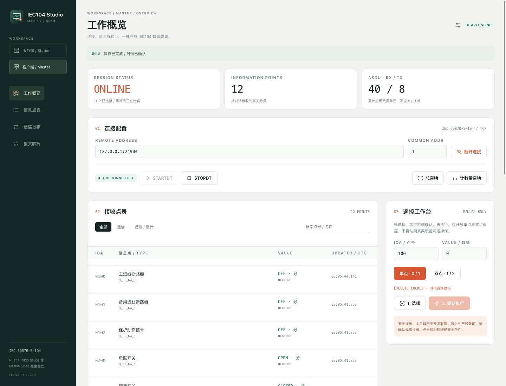

# Tokio IEC104 / IEC104 Studio

基于 Tokio 的 IEC 60870-5-104 协议库，包含 **NSH 原生服务端与客户端界面**。

已按 [nicedvx/tokio-iecp5](https://github.com/nicedvx/tokio-iecp5) 的
`77ed90917891fa1a1f2b61290de49ad19a8bd672` 同步功能差异，保留本项目的中文协议注释和独立测试。
详细差异及 API 兼容性变化见 [上游同步记录](docs/UPSTREAM.md)。

## 文档导航

- [工作台操作、架构与 API](docs/STUDIO.md)
- [独立应用安装、打包和故障排查](docs/PACKAGING.md)
- [图标设计、资源与再生成](docs/ICONS.md)
- [上游同步与兼容性](docs/UPSTREAM.md)

## 应用图标

| 客户端 / Master | 服务端 / Station |
|:---:|:---:|
|  |  |
| 控制终端、信号脉冲与发送箭头 | 双层机架、状态灯与连接节点 |
| `IEC104 Client` · `ui/client/` | `IEC104 Server` · `ui/server/` |

两端使用独立的名称、应用 ID 和系统图标。界面侧栏随当前角色切换图标，导航与操作按钮使用统一线性图标；
所有资源随应用离线打包，不依赖 CDN 或图标字体。

## 界面



深绿侧栏、暖白工作区与橙色操作强调；服务端和客户端可以分别开窗，也可以在同一窗口切换。
界面由 [longbridge/nsh](https://github.com/longbridge/nsh) 原生渲染，**不是 HTML 套壳或静态仪表盘**。

- 服务端：启停监听、多连接会话计数、12 个内存模拟点、点值编辑、总召唤/计数量召唤响应。
- 客户端：TCP 连接、STARTDT/STOPDT、总召唤、累计量召唤、六类数据点解码。
- 遥控：单点/双点选择与执行、对端确认、3 秒确认超时、10 秒选择有效期；选择本身不改变点值。
- 工具：点表搜索/分类、最近 300 条通信事件、ASDU 十六进制查看、I/S/U 报文解析。
- 安全默认：无自动连接/遥控；控制 API 和模拟站点仅监听回环地址；API 使用随机 Token。

## 快速运行

需要 Rust/Cargo 和 **NSH CLI 0.3.0**（本项目已在此版本验证；主分支文档的部分 API 与发布版不同）。
macOS 可用 `brew install longbridge/tap/nsh`；其他平台见 [NSH 安装文档](https://nsh.dev/docs/installation)。

在三个终端分别运行：

```sh
# 1. Rust 本地控制服务（启动后打印 API Token）
cargo run --features console --bin iec104-console

# 2. NSH 服务端窗口
nsh run ui/server --target macos --window-size 1440x1000

# 3. NSH 客户端窗口
nsh run ui/client --target macos --window-size 1440x1000
```

两个窗口中填入同一 API Token，点击“连接控制服务”。默认 API 地址为
`http://127.0.0.1:24040`，不会保存 Token 到文件。

1. 服务端：默认地址 `127.0.0.1:2404`、公共地址 `1`，点击“启动监听”。
2. 客户端：连接同一地址，点击 `STARTDT`，再点“总召唤”和“计数量召唤”。
3. 遥控：点击点表，再点“载入点”，填写目标数值，先“选择”，确认后在 10 秒内“执行”。
4. 服务端编辑点值后，客户端重新召唤读取；不会自动广播给所有会话。
5. 退出前可停止监听、断开连接；控制服务收到 Ctrl-C 会清理连接。

Web 预览用 `nsh run ui/client --target web` 或 `nsh run ui/server --target web`；Windows/Linux 分别改成 `--target windows` /
`--target linux`。**已实际验证 macOS 原生与 Web；其他平台尚未运行验证。**
[服务端截图](docs/screenshots/server.png) · [架构、API 与限制](docs/STUDIO.md)

### 安装带独立系统图标的 macOS 应用

`nsh run` 是共享开发宿主；要让 Dock / Finder 显示各自的图标，使用独立打包产物：

```sh
nsh package ui/client --target macos --out "$PWD/dist/macos/client"
nsh package ui/server --target macos --out "$PWD/dist/macos/server"
open "dist/macos/client/IEC104 Client.app"
open "dist/macos/server/IEC104 Server.app"
```

应用包仅包含 UI，**仍需单独启动 Rust 控制服务**。Windows、Linux、Web 的产物及签名说明见
[打包文档](docs/PACKAGING.md)。旧入口 `ui/App.tsx`、`ui/Server.tsx` 仍保留，但独立发布请使用
`ui/client/`、`ui/server/`，避免共用旧根目录的应用 ID 和客户端默认图标。

可选环境变量：

```sh
# Token 至少 16 字符；不设置则每次生成新的随机 Token
IEC104_TOKEN='your-long-local-secret' IEC104_API_ADDR=127.0.0.1:24040 \
  cargo run --features console --bin iec104-console
```

## 仅使用协议库 / 报文工具

UI 和 HTTP 依赖使用可选的 `console` feature，不影响默认库依赖。

```sh
cargo test --all-targets
cargo run --example server
cargo run --example client
cargo run --example parse_104 -- '[68] [04] [07] [00] [00] [00]'
# 支持多个粘连帧；非法十六进制、错误控制字段及截断帧会报错
cargo run --example parse_104 -- '68 04 07 00 00 00 68 04 83 00 00 00'
```

## 验证

```sh
cargo test --all-features --all-targets
cargo clippy --all-features --all-targets
nsh check ui
nsh check ui/client
nsh check ui/server
nsh test ui
python3 -m unittest discover -s tests -p 'test_ui_assets.py' -v
```

实际端到端 UI 测试（会操作本机模拟站点并更新截图，使用专用的 24904/24940 端口，避免影响默认开发服务）：

```sh
# 终端 A；此固定 Token 仅用于测试
IEC104_API_ADDR=127.0.0.1:24940 IEC104_TOKEN=iec104-local-smoke-token \
  cargo run --features console --bin iec104-console
# 终端 B
nsh test tests/ui/workflow.test.tsx --target web
# 或验证 macOS 原生窗口：
nsh test tests/ui/workflow.test.tsx --target macos
```

图标源文件和 PNG 已随项目提供，正常开发/打包无需额外图形工具；需要重新生成时执行
`python3 scripts/generate-icons.py`，详见 [图标维护文档](docs/ICONS.md)。

## 使用边界

这是开发联调工作台，不是生产 SCADA。模拟点表/日志仅驻留内存，控制 API 不提供远程管理，
不包含 TLS、持久化、用户权限、完整的 IEC104 k/w 滑动窗口或所有类型的业务处理。
协议库的通用 `send_asdu` 仍然表示入队；**确认/超时机制在控制台业务层实现**，并非全库通用命令事务。
具体见 [限制说明](docs/STUDIO.md#限制与安全)。

## 术语解释

1. DCO - Double Command Output（双点命令输出）
DCO 用于表示双点遥控命令。它允许控制具有两个稳定状态的设备，例如断路器（开/关）。

2. QOC - Qualifier of Command（命令限定词）
QOC 用于进一步定义命令的性质或执行方式。它可以包含诸如短脉冲/长脉冲、选择/执行等信息。

3. QOS - Qualifier of Set-point Command（设定点命令限定词）
QOS 用于设定点命令，提供关于如何执行设定点操作的附加信息。

4. QOI - Qualifier of Interrogation（总召唤限定词）
QOI用于定义总召唤命令的类型。总召唤是一种请求设备发送其所有当前数据的命令。QOI可以指定不同类型的总召唤,例如:

站总召唤
特定组的召唤
计数器总召唤

5. QCC - Qualifier of Counter Interrogation Command（计数器召唤命令限定词）
QCC用于计数器召唤命令,指定要读取的计数器类型和读取方式。它可以包含以下信息:

请求计数器的类型(如积分计数器、运行时间计数器等)
是否冻结计数器值
是否重置计数器


6. QRP - Qualifier of Reset Process Command（复位进程命令限定词）
QRP用于复位进程命令,指定要执行的复位类型。这可能包括:

特定设备或过程的复位
特定类型事件的复位
全系统复位

7. SIQ - Single-point Information with Quality descriptor（带品质描述词的单点信息）
SIQ 用于传输单个二进制状态信息(如开/关),同时包含了描述该信息质量的附加数据。品质描述词可能包括:

是否被封锁
是否被取代
是否为拓扑信息
是否有效


8. DIQ - Double-point Information with Quality descriptor（带品质描述词的双点信息）
DIQ 类似于SIQ,但用于表示具有两个稳定状态的设备信息。例如,断路器可能有以下状态:

中间态
确定开
确定关
不确定态
DIQ同样包含品质描述词。


9. QDS - Quality Descriptor（品质描述词）
QDS 是一个通用术语,指包含数据点品质信息的描述符。它可能包括:

溢出标志
封锁标志
取代标志
拓扑标志
有效性标志


10. BCR - Binary Counter Reading（二进制计数器读数）
BCR 用于传输计数器的当前值,通常用于电能计量等应用。它包括:

计数器值
序列号
溢出标志
调整标志
无效标志


11. SCD - Status and Change Detection（状态和变位检测）
SCD 用于传输设备的当前状态以及自上次报告以来是否发生了变化。它通常包含:

当前状态信息
变位检测信息
品质描述词

12. SCO（Single Command Output）用于发送单点控制命令，通常用于控制只有两个状态的设备。具体来说：

用途：SCO 主要用于控制开关设备，如断路器、隔离开关等。
状态：它通常表示两种状态，例如：

0 = 关闭 (OFF)
1 = 打开 (ON)


结构：SCO 通常包含以下信息：

命令值（0或1）
选择/执行标志
限定词（Qualifier），提供额外的控制信息

应用：在SCADA（监控与数据采集）系统中，SCO用于远程控制设备的开关状态。
与DCO的区别：SCO用于单点控制，而DCO（Double Command Output）用于双点控制，后者提供更多的状态信息。

这些限定词(Qualifiers)在IEC104协议中扮演着重要角色,它们提供了额外的上下文和精确性,确保控制中心和远程终端单元(RTU)之间的通信明确无误。
这对于电力系统、工业控制和其他需要高度可靠性的应用至关重要。

- S/E (Select/Execute)：选择/执行标志

S/E 是一个重要的安全特性，用于实现两步式控制过程：

S/E = 1：表示“选择”命令。它用于预先选择一个设备或操作，但不会立即执行。
S/E = 0：表示“执行”命令。它用于执行先前已选择的操作。

这种两步式过程（先选择，后执行）提高了操作的安全性，减少了误操作的风险。通常的操作流程是：

1. 发送选择命令（S/E=1）
2. 等待确认
3. 发送执行命令（S/E=0）
4. 执行操作

S/E 机制允许操作员在实际执行命令之前确认选择是否正确，这在控制关键设备时特别重要。
QOS 通过组合QL和S/E，为设定点命令提供了全面的控制和安全机制，确保命令能够安全、准确地执行。

- QL

QL (Qualifier of command)：命令限定词

QL 用于进一步定义设定点命令的执行方式。它通常包含以下信息：

持续时间或脉冲长度（短脉冲/长脉冲）
执行方式（如直接执行、带确认执行等）
阻塞/解除阻塞
其他特定于应用的限定信息

QL的具体含义可能因应用场景而异，但它总是用来提供关于如何执行命令的额外指示。