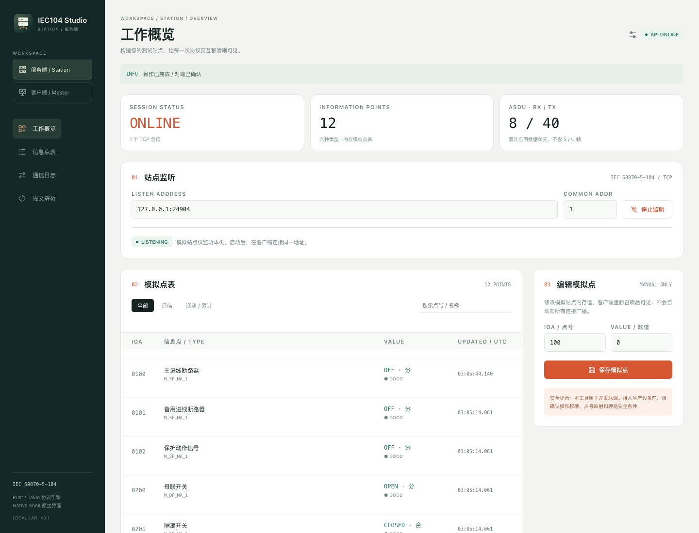

# IEC104 Studio：架构与操作说明

## 架构

```text
NSH 服务端窗口 ui/server/         NSH 客户端窗口 ui/client/
              │                            │
              └──── 本地 HTTP + Token ──────┘
                              │
                 iec104-console / Axum
                      127.0.0.1:24040
                    ┌─────────┴─────────┐
                    │                   │
               Server / Tokio      Client / Tokio
               模拟从站/被控站      主站/控制站
               127.0.0.1:2404 ←── IEC104 TCP ──┘
```

- `src/client.rs`、`src/server.rs`、`src/codec/`：协议传输层，不依赖 UI。
- `src/console.rs`：可选业务层，管理任务、点表、会话、确认事务及 HTTP API。
- `src/inspect.rs`：CLI 和工作台共用的十六进制/帧解析。
- `ui/shared/store.ts`：带超时/取消的 API 请求、每秒状态轮询、选择状态。
- `ui/shared/Studio.tsx`：两种入口共用的 NSH 组件、工作区和响应式布局。
- `ui/shared/Icons.tsx`：本地 PNG 应用标记与 SVG 线性图标，保留按钮文字及无障碍标签。
- `ui/shared/icon-data.ts`：生成的小图标内嵌字节，规避独立应用根目录之外的资源路径问题。
- `ui/client/`、`ui/server/`：独立入口、元数据和图标配置，打包后可以同时安装。

NSH 渲染原生控件；原生端的 `fetch` 使用平台网络栈。浏览器模式需要 CORS，因此 API 仅向
`http://localhost` / `127.0.0.1` / `[::1]` 来源开放 CORS；所有读取和写入仍需要 Token。
无论原生还是 Web，都不是在浏览器中实现 IEC104 TCP：协议始终运行在 Rust 进程。

一个 Rust 进程管理一个模拟站点和一个客户端。两个窗口共享该进程的状态；任一窗口也可以通过
侧栏切换 Station/Master。关闭窗口不会擅自停止另一个窗口正在使用的协议任务；请在 UI 中停止，
或者对 Rust 控制服务发送 Ctrl-C。

## 界面

客户端为“控制终端＋信号脉冲”，服务端为“双层机架＋连接节点”。图标采用同一深绿底色，
分别使用薄荷绿和暖橙色区分；侧栏、角色切换、导航与主要操作均有配套图标。切换角色会改变
**界面内图标**，不会改变已安装应用的固定名称、Bundle ID 或 Dock 图标。开发宿主与独立应用图标的
区别、安装步骤见 [打包说明](PACKAGING.md)；设计和生成方式见 [图标说明](ICONS.md)。

- **工作概览**：会话状态、点数、累计 ASDU RX/TX、连接配置、点表、手动操作面板、近期日志。
- **信息点表**：按名称/点号搜索，按遥信和遥测/累计分类，查看类型、数值、品质与 UTC 接收时间。
- **通信日志**：最多 300 条，按当前角色过滤，可显示 ASDU 字节。清空操作对两个窗口共同生效，
  不会重置累计计数。SYS 事件表示生命周期/明确控制动作，TX 表示 ASDU 已入发送队列，不是抓包证据。
- **报文解析**：I/S/U 帧、多个粘连帧、原始 ASDU 与解码点值；非法字符/长度/控制字段会报错。

两个入口的真实运行截图：




### 内置点表

| 类型 | IOA | 说明 |
|---|---|---|
| 单点遥信 | 100–102 | 0/1，允许单点选择/执行 |
| 双点遥信 | 200–201 | 1=分、2=合，允许双点选择/执行 |
| 归一化遥测 | 300 | 原始 i16 NVA 值，不自动换算工程单位 |
| 标度化遥测 | 400–401 | 原始 i16 值 |
| 短浮点遥测 | 500–501 | f32，电压和频率的模拟值 |
| 累计量 | 600–601 | i32，计数量召唤返回 |

全站总召唤返回前五类共 10 点；计数量召唤返回 2 点。每点单独编码为 ASDU，避免超长帧。
总召唤按 `ACT_CON → 数据 → ACT_TERM` 返回。只接受 QOI=20、QCC=5，其他限定词否定确认，
不假装实现分组查询/冻结/复位。

连接本进程自己的模拟站点时使用上述名称。**IEC104 不传递点名**；连接其他设备时只显示
“信息点 IOA”，不会把模拟站点的名称强行套用到真实设备。时间列表示本机接收/更新时间，
不是设备事件发生时刻。品质异常独立显示；非法浮点值转换为占位 0 并标记 IV，不作为 GOOD 值展示。

### 遥控安全流程

1. 输入点号/数值或从点表载入。
2. 点击“1. 选择”，发送 S/E=1 的 C_SC_NA_1 / C_DC_NA_1。
3. 在 3 秒内收到匹配类型、CA、payload 的肯定 ACT_CON 后，才解锁执行按钮。
4. 10 秒内点击“2. 确认执行”，发送 S/E=0，并等待 ACT_TERM。
5. 模拟站点只接受**同一 TCP 会话**成功选择过的相同点号、类型和值。
6. 选择不修改点值。执行修改后，通过同一会话发送自发遥信，再发送 ACT_TERM。

修改控制参数、切换角色、断开/停止传输、Token/API 失联会使 UI 的执行锁重新关闭。
执行授权为一次性；重复执行必须重新选择。服务端同时独立校验，不能通过直接调用 API 跳过。
客户端操作失败会显示明确错误，而不是把“发送入队”当成成功。

## 本地 API

默认地址 `http://127.0.0.1:24040`。环境变量 `IEC104_API_ADDR` 可以改变回环地址/端口，
但不能设置成非回环地址。`IEC104_TOKEN` 至少 16 字符；省略时自动生成，启动时显示。
UI 不持久化 Token，读取快照也需要 `X-IEC104-Token`。

```sh
curl -H "X-IEC104-Token: $IEC104_TOKEN" http://127.0.0.1:24040/api/state

curl -X POST http://127.0.0.1:24040/api/action \
  -H "X-IEC104-Token: $IEC104_TOKEN" \
  -H 'Content-Type: application/json' \
  -d '{"action":"server_start","address":"127.0.0.1:2404","common_addr":1}'
```

若使用自动生成的 Token，先将终端显示的值导出为 shell 的 `IEC104_TOKEN` 再使用上述 curl。
HTTP 200 表示该控制台动作成功；400 表示业务/协议失败；401 表示未授权；
不合法 JSON/schema 由 Axum 返回 400/422。控制动作串行执行，状态读取仍可并行。

| action | 额外字段 | 行为 |
|---|---|---|
| `server_start` | `address`, `common_addr` | 启动回环模拟站点；API 支持端口 0，响应状态含实际端口 |
| `server_stop` | — | 停止监听及全部已接受会话 |
| `client_connect` | `address`, `common_addr` | 建立 TCP，最多等待 5 秒；不自动 STARTDT，不自动重连 |
| `client_disconnect` | — | 取消并关闭客户端任务 |
| `start_dt` / `stop_dt` | — | 等待 U 帧状态确认，最多 3 秒 |
| `interrogation` / `counter_interrogation` | — | 等待召唤终止，最多 3 秒 |
| `select` / `execute` | `ioa`, `kind`, `value` | `kind` 为 `single` / `double`；按上述流程等待确认 |
| `update_point` | `ioa`, `value` | 校验类型范围后修改模拟点表 |
| `parse` | `hex` | 返回 `description`；不发送任何协议帧 |
| `clear_logs` | — | 清空有界日志，不清累计计数 |

公共地址/工作台点号为 1..65534。归一化/标度化值为 i16 整数，累计量为 i32 整数，
浮点值必须有限且能用 f32 表示。协议库原有 `InfoObjAddr` 仍沿用低 16 位地址模型。

## 版本与验证

NSH **0.3.0 (`76fa8a7`)** 已验证。该发布版 `nsh/base` 的 Input `onChange` 直接接收字符串，
与本次查看的 main 文档 `{ value }` 示例不同；以实际安装版本生成的 `.nsh/types` 为准。
`nsh check ui` / `nsh test ui` 不需要 npm、React 或浏览器。生成的 `.nsh/` 目录已忽略。
独立入口也可执行 `nsh check ui/client`、`nsh check ui/server`。8 项 headless UI 测试包含两个独立
入口的图标/角色切换与无自动网络行为；3 项 Python 离线检查覆盖 SVG、PNG 完整性和应用身份。
macOS 打包已检查两个应用的 `Info.plist` / `AppIcon.icns`，Web 打包已检查 favicon 和 manifest 图标。

- Rust 默认及 `console` feature 测试。
- NSH headless 的 stub 网络界面测试，不接触设备。
- NSH macOS 原生和 Web 的**真实 TCP**流程：启动站点 → 连接 → STARTDT → 总召唤 →
  计数量召唤 → 选择 → 执行 → 值反馈 → 停止监听；截图来自这条流程。
- Windows、Linux、iOS、Android 尚未实机验证；不因 NSH 支持这些平台而宣称本项目已全部验收。

详见根 README 的测试命令。实机流程使用独立 `tests/ui/` NSH 测试项目，默认 `nsh test ui`
只执行 stub 测试，不依赖正在运行的 API。实机测试使用专用的 24940/24904 端口和测试 Token（启动命令见根 README），
不应连接生产设备。

## 限制与安全

- 开发/实验室工作台，**不是生产 SCADA，也不是经过认证的完整 IEC104 协议栈**。
- 一个工作台实例仅管理一个客户端/一个模拟站点；模拟站点可以接受多个 TCP 会话。
- 模拟站点仅监听本机。客户端可由操作者明确输入实际远端 **IP:端口**，但没有 TLS/鉴权/权限模型。
- 点表、日志、选择状态在内存中，不持久化；不提供历史库、配置导入导出或自由新增点位。
- UI 仅开放单/双点遥控；协议库现有设定点/比特串 API 保留，但没有在工作台中伪造完整业务处理。
- 模拟点值编辑不会自动向所有会话广播；执行反馈仅发给发起该命令的连接。
- 原库仍缺少完整 k/w 滑动窗口/背压配置，采用无界发送队列；业务处理器也不能无限期阻塞。
  不应据此声称实现 IEC104 全部互操作要求。
- 通用发送 API 表示入队；本项目的确认等待在**控制台业务层**，不是新增全库通用命令事务。
- 显示的 HEX 为 ASDU 数据，不包含完整 APCI/TCP，也不是 Wireshark/网络抓包工具。
- Token 防止未授权网页直接操作本机 API，但不是完整多用户安全系统；拥有 Token 的本机进程可以控制会话。
